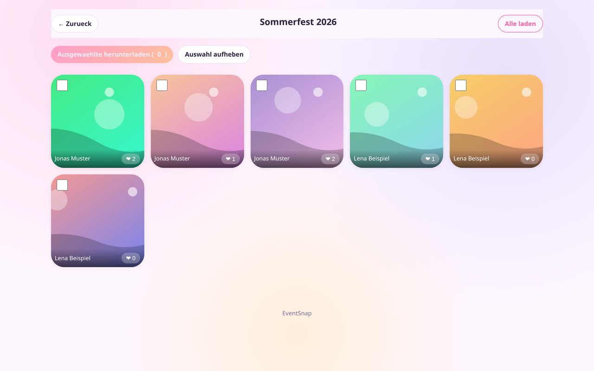
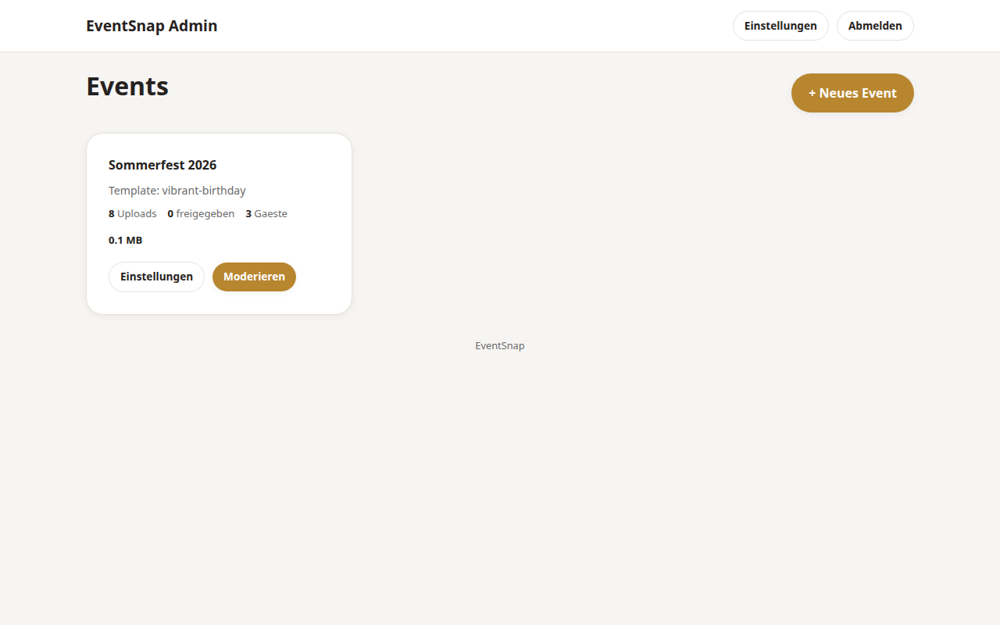
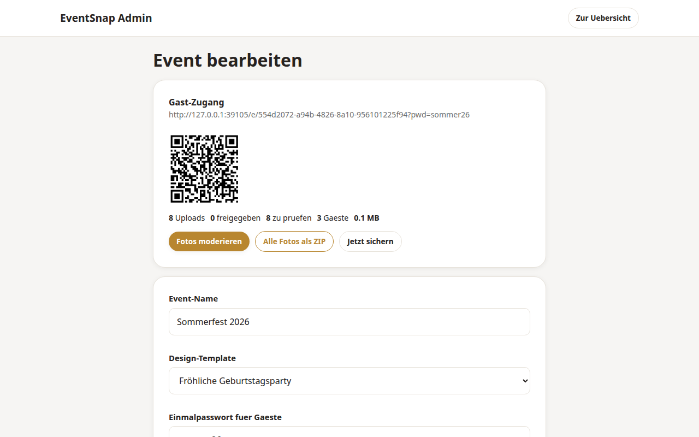
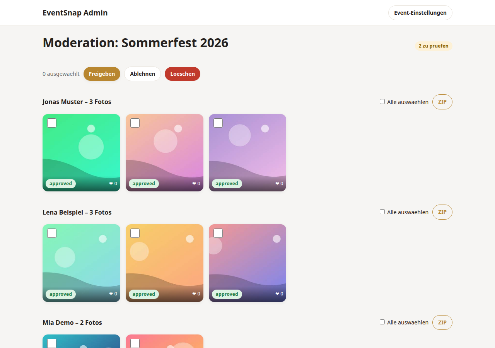
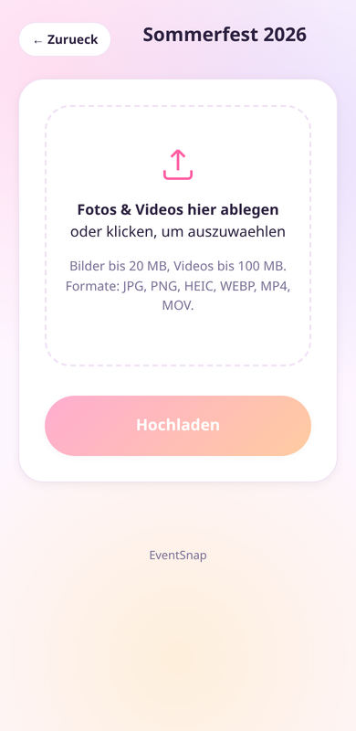
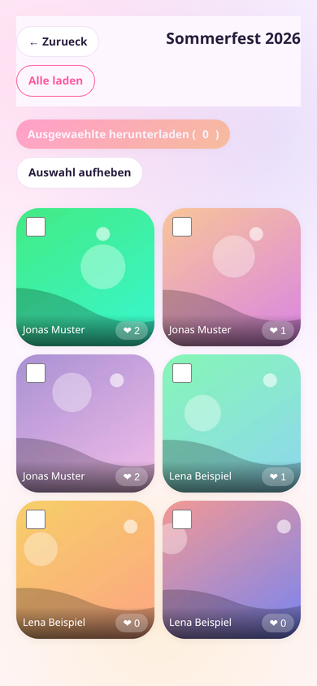

# EventSnap

Moderne, responsive Web-App zum Sammeln und Teilen von Gaeste-Fotos bei Feiern
(Hochzeit, Geburtstag, Firmenevent, ...). Multi-Event-faehig, JSON-basiert
(keine SQL-Datenbank), Docker-deploybar.



## Features

- Admin-Dashboard: Events anlegen/bearbeiten/loeschen, QR-Code + Link pro Event
- Globale Admin-Einstellungen (`/admin/einstellungen`): Basis-URL/Domain aendern
  (Hinweis auf noetigen manuellen Neustart) sowie Admin-Passwort aendern (wirkt
  sofort, kein Neustart noetig)
- 8 Design-Templates, pro Event waehlbar: Elegante Hochzeit, Froehliche
  Geburtstagsparty, Firmenevent, Modern & Minimalistisch, Rustikales Fest,
  Bunte Party, Bordeaux & Gold, Petrol & Koralle
- Gast-Zugang per Link/QR-Code + Einmalpasswort, danach Namenserfassung (Session/Cookie)
- Foto-/Video-Upload (Mehrfachauswahl, Drag&Drop, Fortschrittsbalken), serverseitige
  Komprimierung + Thumbnail-Erstellung (sharp)
- Foto-Moderation gruppiert nach Gast, Freigeben/Ablehnen/Loeschen (einzeln oder in Bulk)
- Gaeste-Galerie mit Like-Funktion, Einzel-/Mehrfach-/Gesamt-Download als ZIP
- Anonymitaets-Schalter (Uploader-Namen anzeigen oder verbergen)
- Upload- und Sichtbarkeits-Zeitfenster unabhaengig voneinander konfigurierbar
- Optionales automatisches Backup pro Event (konfigurierbares Intervall)

## Screenshots

| Ansicht | Beschreibung |
|---|---|
|  | Admin-Übersicht der Events. |
|  | Event mit Gast-Link, QR-Code, Statistik und Einstellungen. |
|  | Moderation: Uploads nach Gast gruppiert, freigeben, ablehnen, löschen. |
|  | Upload-Seite für Gäste (Handy). |
|  | Galerie mit Likes und Download (Desktop). |
|  | Galerie auf dem Handy. |

Die Screenshots zeigen eine eigens angelegte Demo-Instanz mit generierten Beispielbildern (keine echten Fotos oder Personen).

## Bedienung

1. Unter `/admin` mit dem Admin-Passwort anmelden.
2. **Neues Event**: Name, Design-Template und Einmalpasswort für Gäste festlegen, optional Zeitfenster und Backup.
3. Auf der Event-Seite Link oder QR-Code an die Gäste geben.
4. Gäste öffnen den Link, geben ihren Namen an, wählen **Fotos hochladen** und senden ihre Dateien.
5. Unter **Fotos moderieren** Uploads auswählen und **Freigeben**, **Ablehnen** oder **Löschen**.
6. Freigegebene Fotos erscheinen in der Galerie; Gäste liken und laden herunter. Admin: **Alle Fotos als ZIP**.

## Fehlersuche

- QR-Code zeigt falsche Adresse: `BASE_URL` unter Einstellungen setzen und `docker compose restart` ausführen.
- Gäste sehen keine Fotos: Uploads müssen erst freigegeben werden; Sichtbarkeits-Zeitfenster des Events prüfen.
- Upload wird abgelehnt: erlaubte Formate JPG, PNG, HEIC, WEBP, MP4, MOV und Größenlimits (`MAX_UPLOAD_SIZE_IMAGE/VIDEO`) beachten.
- Hinter einem Reverse Proxy: `TRUST_PROXY=true` setzen.

## Architektur

Sämtliche Datenzugriffe (Events, Fotos, Metadaten, Likes, globale
Admin-Konfiguration, `.env`-Werte wie `BASE_URL`) laufen ausschliesslich ueber
`src/dataStore.js`. Routen und Views greifen nie direkt auf das Dateisystem zu,
sondern nur ueber die dort exportierten Funktionen (`getEvent`, `addPhoto`,
`updatePhotoStatus`, `getPhotosByEvent`, `getAdminConfig`, `setEnvValue`, ...).
Dadurch kann das Speicher-Backend spaeter (z.B. gegen eine SQL-Datenbank)
ausgetauscht werden, ohne Routen/Views anzufassen. Aktuell: reine JSON-Dateien
pro Event unter `data/events/{id}/`. Die Passwort-Hashing-Logik selbst liegt in
`src/adminAuth.js`, das ausschliesslich ueber `dataStore.js` persistiert.

```
data/
  admin-config.json     Globale Admin-Konfiguration (u.a. gehashtes Admin-Passwort)
  events/{event-id}/
    config.json        Event-Settings
    metadata.json       Foto-Metadaten (Uploader, Zeitstempel, Status, Likes)
    uploads/{guest-folder}/original/   Originaldateien (komprimiert)
    uploads/{guest-folder}/thumbs/     Thumbnails
  backups/{event-id}_{timestamp}/      Backups (optional, siehe unten)
```

Das Admin-Passwort wird ausschliesslich in `data/admin-config.json` verwaltet
(bcrypt-Hash, ueber `src/adminAuth.js` + `src/dataStore.js`). `ADMIN_PASSWORD`
in der `.env` wird nur beim allerersten Start gelesen, um diese Datei einmalig
zu erzeugen (Migration) - siehe Abschnitt "Admin-Passwort & Domain aendern".

## Setup (lokal ohne Docker)

```bash
npm install
cp .env.example .env   # Werte anpassen, siehe unten
npm start
```

Die App lauscht danach auf `0.0.0.0:$PORT` (Standard 3005).

## Setup (Docker)

```bash
cp .env.example .env   # Werte anpassen
docker compose up -d --build
```

Volume `./data` wird nach `/app/data` gemountet und enthaelt alle Events, Fotos
und Backups persistent.

## Umgebungsvariablen (.env)

| Variable | Pflicht | Beschreibung |
|---|---|---|
| `ADMIN_PASSWORD` | nur fuer Erstinstallation | Admin-Passwort, wird **nur beim allerersten Start** gelesen und dann gehasht nach `data/admin-config.json` migriert. Danach wird dieser Wert komplett ignoriert - Passwort aendern nur noch ueber `/admin/einstellungen` im Admin-Bereich (wirkt sofort). |
| `SESSION_SECRET` | empfohlen | Geheimnis zum Signieren der Session-Cookies |
| `PORT` | nein (3005) | Port, auf dem die App lauscht |
| `BASE_URL` | ja fuer QR-Codes | Oeffentliche URL der App (z.B. `https://fotos.example.com`), wird zur Generierung der QR-Codes/Gast-Links verwendet. Aenderbar ueber `/admin/einstellungen`; erfordert danach einen manuellen Container-Neustart (`docker compose restart`), damit neue QR-Codes die neue Domain verwenden. |
| `MAX_UPLOAD_SIZE_IMAGE` | nein (20) | Max. Bildgroesse in MB |
| `MAX_UPLOAD_SIZE_VIDEO` | nein (100) | Max. Videogroesse in MB |
| `TRUST_PROXY` | nein | Auf `true` setzen, wenn die App hinter einem Reverse Proxy laeuft |

Zugangsdaten stehen ausschliesslich in `.env` (nie in `docker-compose.yml` oder
im Quellcode); `.env` ist in `.gitignore` ausgeschlossen. Das Admin-Passwort
selbst liegt nach der Erstmigration nicht mehr in `.env`, sondern gehasht in
`data/admin-config.json` (ebenfalls nicht in Git, da `data/` in `.gitignore`
steht).

## Admin-Passwort & Domain aendern

Im Admin-Bereich unter **Einstellungen** (`/admin/einstellungen`, Menuepunkt im
Dashboard):

- **Admin-Passwort aendern**: aktuelles Passwort bestaetigen, neues Passwort
  (mind. 8 Zeichen) zweimal eingeben. Wird sofort wirksam, kein Neustart
  noetig. Beim allerersten Start der App wird automatisch das bestehende
  `ADMIN_PASSWORD` aus der `.env` gehasht uebernommen (Migration nach
  `data/admin-config.json`); ab diesem Zeitpunkt ist der `.env`-Wert
  bedeutungslos.
- **Basis-URL/Domain aendern**: Wert wird in die `.env` geschrieben (bestehende
  andere Variablen bleiben erhalten). Danach erscheint ein Hinweis, dass ein
  manueller Container-Neustart (`docker compose restart`) noetig ist, damit
  neu erzeugte QR-Codes/Gast-Links die neue Domain verwenden. Es erfolgt
  **kein** automatischer Neustart.

## Betrieb hinter Reverse Proxy

Die App aktiviert bei `TRUST_PROXY=true` intern `app.set('trust proxy', 1)`,
damit Express Client-IP und Protokoll (`X-Forwarded-*`) korrekt auswertet.
Empfohlener Betrieb: eigene Subdomain im Nginx Proxy Manager (oder aehnlich)
mit HTTPS-Terminierung am Proxy, Weiterleitung an `http://<host>:3005`. Setze
`BASE_URL` auf die oeffentliche HTTPS-Adresse, damit generierte QR-Codes und
Gast-Links korrekt sind.

## Backups

Pro Event im Admin-Bereich aktivierbar ("Automatisches Backup aktivieren" +
Intervall in Stunden). Ein Backup kopiert `data/events/{id}` komplett nach
`data/backups/{id}_{timestamp}`. Zusaetzlich kann jederzeit manuell im
Event-Bearbeiten-Dialog ueber "Jetzt sichern" ein Backup ausgeloest werden.
Backups werden nicht automatisch geloescht/rotiert – bei Bedarf manuell im
`data/backups/`-Ordner aufraeumen.

## Sicherheit

- Datei-Uploads werden per Dateiendung auf jpg/jpeg/png/heic/heif/webp/mp4/mov
  geprueft, Groessenlimits gelten separat fuer Bilder und Videos.
- Login-Endpunkte (Admin + Gast-Event-Passwort) sind rate-limitiert.
- Gaeste-Namen werden vor Anzeige/Verwendung als Ordnername bereinigt.
- Alle zustandsaendernden Formulare sind per Session-CSRF-Token geschuetzt.

## Download

Über **Code → Download ZIP** oder unter **Releases** auf GitHub.

## Lizenz

MIT-Lizenz, siehe die Datei `LICENSE` im Projekt.

---

## English summary

EventSnap collects guest photos at events: share a QR code, guests upload from their phones, you moderate, everyone browses the gallery. JSON-based (no SQL database), runs with `docker compose up -d --build` (port 3005).
